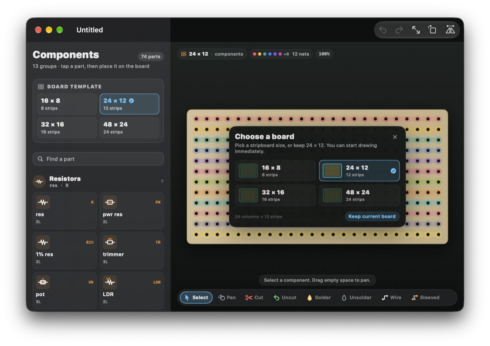

# stripmaster

A SwiftUI document app for designing stripboard circuits on macOS and iOS.

Stripboard (Veroboard-style) construction is a different medium from a
schematic or a PCB: components are pushed through holes, copper strips are cut
to isolate sections, and connections are made with bare or insulated jumpers.
stripmaster is built around those operations. It shows the component side by
default and can flip the board to its copper side, where cuts, pin tips, solder
joints and tracks are visible.



## Features

- **Four board templates** — 16 × 8, 24 × 12, 32 × 16 and 48 × 24 holes. Every
  template has its long axis running along the copper strips. New boards are
  landscape by default; the last orientation and zoom are restored when a board
  is reopened.
- **Top and bottom views** — the component side is shown first. The toolbar
  flip button shows the mirrored copper side, including tracks, drilled holes,
  component pin tips and solder joints, so it is obvious where to cut and what
  passes through where.
- **Fit and rotate** — fit the board to the window, rotate in 90° steps, and
  pan/zoom like a normal canvas app.
- **A real component palette** — 74 parts in 13 groups, with bold hand-drawn
  vector icons, short names, tiny names, leg counts, polarisation and stretch
  limits. Parts can be placed on the board and adjusted.
- **Stripboard tools** — cut and un-cut holes, solder and unsolder pins/holes,
  and draw two kinds of jumper:
  - **Wire** — bare tinned wire, conductive along its entire length.
  - **Sleeved** — insulated jumper, conductive only at its two endpoints.
  Jumpers are drawn by dragging. Routes are snapped to hole centres and may only
  move horizontally or vertically between adjacent holes, so arbitrary
  orthogonal shapes are possible but diagonals are not representable.
- **Connectivity overlay** — the board is treated as a graph of holes and
  conductive links. Every disjoint copper net is tinted in a different
  semi-transparent colour, and the palette explains the colours. The overlay
  updates while you edit.
- **Autosave** — changes are coalesced for 350 ms and then marked dirty with
  SwiftUI's document machinery, which autosaves the document. Both edits and
  view-only changes (pan, zoom, rotate, flip) are saved.
- **History, undo and redo** — document edits are recorded as reversible
  commands and saved inside the `.stripmaster` file. Undo/redo use that persisted
  history, including after quitting and reopening. View changes are deliberately
  *not* history entries.

## Requirements

- macOS 27 or iOS 27
- Xcode 27.1 or newer
- [XcodeGen](https://github.com/yonaskolb/XcodeGen) (`brew install xcodegen`)

The app uses SwiftUI's newer `Document` protocol (`ReadableDocument` +
`WritableDocument`), `DocumentGroup`, and `URLDocumentConfiguration`.

## Build

The Xcode project is generated from `project.yml` and is not committed.

```sh
xcodegen generate

# macOS
xcodebuild -project Stripmaster.xcodeproj -scheme Stripmaster \
  -destination 'platform=macOS' build

# iOS (device build; no simulator required)
xcodebuild -project Stripmaster.xcodeproj -scheme Stripmaster \
  -destination 'generic/platform=iOS' CODE_SIGNING_ALLOWED=NO build
```

## Tests

### Functional tests (no UI)

The model, document state, edit history, connectivity graph, jumper router,
persistence and autosave debounce are all UI-free. They are compiled and run by a
standalone Swift executable, in the same style as the ljoss model tests:

```sh
./Tests/run-tests.sh
```

That suite currently runs 802 assertions and takes well under a second.

It covers, among other things:

- all four templates and the long-axis strip direction
- hole naming, board metrics and view transforms in every rotation/face
- initial fitting, saved view restoration, zoom anchoring and rotation
- the whole catalogue (structure, values, search, uncommon parts)
- component placement, DIP pin rows, stretching, moving and component hit tests
- right-angle jumper routing, backtracking, validation, and bare-vs-sleeved
  conductivity
- cut semantics, solder-only changes, net partitioning and net colouring
- every edit kind through undo/redo, redo truncation, history persistence
- JSON round-tripping, format versions, sanitisation, corrupt input
- the autosave debounce signal

### UI smoke tests

`StripmasterUITests` contains five basic XCUITests: launch, toolbar/palette/tools
presence, rotate/flip accessibility values, template selection, cutting a hole
and undoing it, and palette selection arming placement.

```sh
xcodebuild -project Stripmaster.xcodeproj -scheme Stripmaster \
  -destination 'platform=macOS' \
  -only-testing:StripmasterUITests test
```

The first run asks macOS for permission to enable UI automation; grant it once.
`xcodebuild build-for-testing` compiles the UI test bundle without needing that
permission.

## Using the editor

- Pick a **board size** in the new-document card, or change it in the palette
  until the first edit.
- Choose a part in the **Components** panel, then click or drag on the board to
  place it. A selected part can be rotated, flipped, stretched, moved or deleted
  from the floating inspector.
- **Cut** / **Uncut** are separate tools. Drag over holes to apply to several at
  once. Cutting removes the copper at that hole and breaks the strip.
- **Solder** / **Unsolder** add or remove a solder joint. A soldered component pin
  is shown as a solder blob on both faces.
- **Wire** is bare and conductive along its path; **Sleeved** is insulated and
  only links its endpoints.
- **Select** a component or drag empty space to pan. The **Pan** tool always pans.
  Pinch to zoom. On macOS, two-finger trackpad scrolling pans the board.
- Toolbar: **Fit to window**, **Rotate 90°**, **Flip board**. Undo and redo are
  in the toolbar on macOS and in the leading menu on iOS. The Board menu also has
  fit, rotate, flip and zoom in/out commands.

On a compact iPhone layout the component palette opens as a sheet from the
"Parts" button or the leading menu.

## File format

`.stripmaster` files are pretty-printed JSON, declared as the exported UTI
`cc.hemsley.stripmaster.board` (conforming to `public.json`). A file contains:

- the board template, cuts, solder marks, jumpers and placed components
- the edit history and the undo cursor (so undo/redo survive relaunch)
- the view state: orientation, which face is shown, zoom, pan and timestamps

The file format carries a version number. Future versions are rejected rather
than silently misread; loaded contents are sanitised so a damaged or hand-edited
file cannot crash the editor.

Autosave is driven by SwiftUI's document autosave. A small debounced signal
registers an undo action after a quiet period; SwiftUI uses that registration to
notice unsaved changes. The app's own undo menu and toolbar use the persisted
edit history instead.

## Project layout

```
Stripmaster/
  App/        App entry point, launch for iOS, menu commands, template sources
  Document/   SwiftUI Document bridge, reader/writer, autosave signal wiring
  Model/      UI-free model: board, edits, history, geometry, graph, file codec
  Views/      Canvas renderer, palette, tool strip, inspector, overlays
  Resources/  Asset catalogue (app icon and accent colour)
Tests/        Standalone functional suite and run-tests.sh
StripmasterUITests/  Basic XCUITest smoke tests
Tools/        App icon generator (optional; uses Pillow)
docs/         Architecture notes
```

### Design notes

- One board unit is the distance between adjacent hole centres. The four
  templates are always longer along the columns, which is the strip direction.
- A cut removes the copper around that hole, so it separates the holes on either
  side and the cut hole itself carries no copper.
- Components are electrical parts, not shorts. They do not create
  hole-to-hole conductivity in the graph. Copper strips, bare jumpers and the
  two endpoints of a sleeved jumper do.
- A bare jumper contacts every hole along its route; a sleeved jumper contributes
  one graph edge between its endpoints and nothing along the sleeve.
- View state lives alongside the history in the document but never inside it.
- Rotation refits the board so the new aspect is visible; flip preserves the
  current zoom and pan.

See `docs/ARCHITECTURE.md` for more detail.

## Licence

No licence has been chosen. This is a private project for the author's use.
